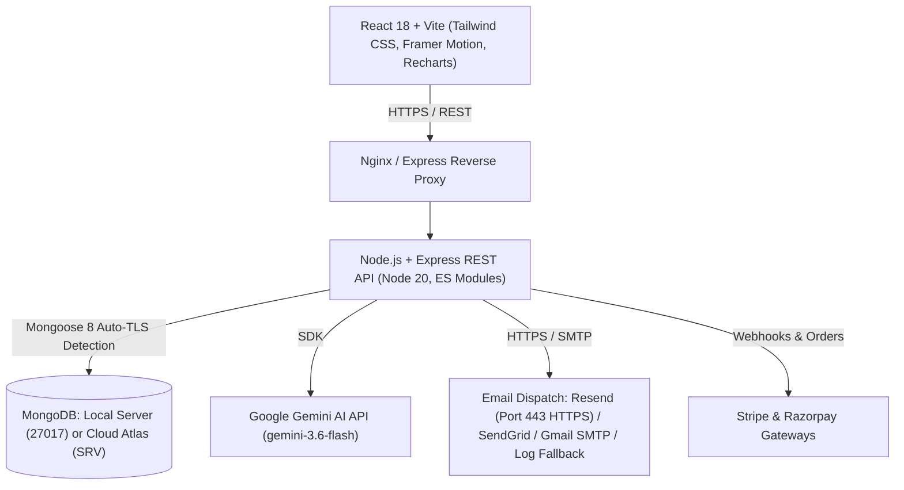

# 🛍️ ShopHub — Full-Stack E-Commerce & AI Platform

[](https://github.com/grvd5678/ecommerce-backend/actions)
[](https://github.com/grvd5678/ecommerce-frontend/actions)
[](https://nodejs.org/)
[](https://opensource.org/licenses/ISC)

A production-ready, full-stack MERN e-commerce platform engineered with a high-performance **React 18 (Vite)** frontend, a secure **Node.js/Express** REST API backend, and dual database support for **Local MongoDB Community Server** and **MongoDB Atlas (Cloud)**. Features executive **Recharts visual analytics**, integrated **Google Gemini AI** (conversational shopping assistant & SEO marketing generator), dual payment gateways (**Stripe & Razorpay**), automated **GitHub Actions CI/CD**, multi-provider email dispatch (**Resend HTTPS API / SendGrid / Gmail SMTP** with server log OTP fallback), and **Docker** containerization.

---

## 🌐 Live Deployments

| Service | Platform | Live URL |
|---|---|---|
| **Frontend Web App** | Render (Static Site) | [https://ecommerce-frontend-l3zz.onrender.com](https://ecommerce-frontend-l3zz.onrender.com) |
| **Backend REST API** | Render (Web Service) | [https://ecommerce-api-tio6.onrender.com](https://ecommerce-api-tio6.onrender.com) |
| **API Health Check** | Render | [https://ecommerce-api-tio6.onrender.com/health](https://ecommerce-api-tio6.onrender.com/health) |

---

## 📑 Table of Contents

- [Architectural Overview](#-architectural-overview)
- [Key Features](#-key-features)
- [Tech Stack](#-tech-stack)
- [Project Structure](#-project-structure)
- [Quick Start (Local Development)](#-quick-start-local-development)
- [Database Setup (Local Community vs. Cloud Atlas)](#-database-setup-local-community-vs-cloud-atlas)
- [Docker Setup (1-Command Orchestration)](#-docker-setup-1-command-orchestration)
- [Environment Variables](#-environment-variables)
- [API Reference](#-api-reference)
- [Testing & CI/CD](#-testing--cicd)
- [Security & Production Hardening](#-security--production-hardening)
- [License](#-license)

---

## 🏗️ Architectural Overview



---

## ✨ Key Features

### 🛍️ Customer Shopping Experience
- **Resilient Authentication & OTP Verification:** Stateless JWT authentication, bcrypt password hashing, and zero-hang OTP verification. Supports **Resend.com** (HTTPS port 443), SendGrid, Gmail SMTP, and auto-logged console OTP fallbacks for cloud hosting environments with blocked SMTP ports.
- **Product Discovery:** Instant search with debounce, multi-criteria filtering (category, price range, ratings), sorting, and dynamic product recommendations.
- **Dynamic Shopping Cart:** Persistent user cart, animated quantity steppers, item exit animations, and promotional coupon engine (`SAVE10`, `SAVE20`, `FLAT50`).
- **Payment Processing:** Integrated dual gateways supporting **Stripe** and **Razorpay** with backend cryptographic signature verification.
- **Order Lifecycle:** Self-service order history, live visual order tracker (`OrderTracker`), and order cancellation workflows.
- **Engagement & Social Proof:** Star ratings, customer review submission, helpful vote counters, and back-in-stock email notifications (`NotifyMe`).

### 📊 Business Intelligence & Admin Suite
- **Visual Analytics Dashboard (Powered by Recharts):**
  - **KPI Metrics:** Total gross revenue, order volume, catalog size, active users, and Average Order Value (AOV).
  - **Revenue & Orders Area Chart:** Gradient timeline tracking daily gross sales.
  - **Fulfillment Donut Chart:** Status breakdown (`Delivered`, `Processing`, `Pending`, `Shipped`, `Cancelled`).
  - **Top 5 Best-Sellers Bar Chart:** Units sold and gross revenue per item.
  - **Category Breakdown:** Inventory distribution grouped by department.
  - **Time Range Filter:** 7 Days, 30 Days, 90 Days, and All-Time data aggregation.
- **Catalog Management:** Full CRUD operations for products with category tagging, stock management, and image asset links.
- **User & Order Management:** Role-based access control (Admin/Customer), order status updates, and user role promotion.

### 🤖 Generative AI Layer (Google Gemini)
- **AI Shopping Assistant:** Conversational chatbot widget on the storefront answering customer queries regarding product features, pricing, and shipping.
- **AI Product Description Generator:** One-click *"✨ Generate with AI"* button in the Admin Product Editor that generates high-converting, SEO-optimized marketing copy from a product title using `gemini-3.6-flash`.

---

## 🛠️ Tech Stack

### Frontend
- **Core:** React 18, Vite 7, React Router DOM v6
- **Styling:** Tailwind CSS, Lucide React icons
- **Data Visualization:** Recharts 2.x
- **Animations:** Framer Motion (Page transitions, cart drawer, micro-interactions)
- **State & Networking:** Context API + useReducer, Axios (with auth interceptors)
- **Notifications:** React Toastify

### Backend
- **Core:** Node.js 20 (ES Modules), Express.js
- **Database:** MongoDB Community Server (Local) & MongoDB Atlas (Cloud), Mongoose 8 (with TLS auto-detection)
- **AI & Cloud Services:** `@google/generative-ai` (Gemini), Resend API, `@sendgrid/mail`, Nodemailer
- **Security:** Helmet, CORS, Express Rate Limit, CSRF protection
- **Testing:** Jest, Supertest, MongoDB Memory Server

### DevOps & Infrastructure
- **Containerization:** Docker, Docker Compose, Multi-stage Nginx builds
- **CI/CD:** GitHub Actions (Automated build verification & Jest test suites)
- **Hosting:** Render (Cloud Native Web Service & Static Site)

---

## 📂 Project Structure

```
ecommerce/
├── docker-compose.yml              # Multi-service local container orchestration
├── README.md                       # Master monorepo documentation
├── ecommerce-backend/
│   ├── .github/workflows/ci.yml    # Backend GitHub Actions CI pipeline
│   ├── config/                     # Database (TLS auto-detect) & config loaders
│   ├── controllers/                # Business logic handlers (auth, products, etc.)
│   ├── middleware/                 # Auth (JWT), Validation (Joi), CSRF, Rate Limit
│   ├── models/                     # Mongoose schemas (8 collections: User, Product, Order, etc.)
│   ├── routes/                     # REST API route definitions
│   ├── tests/                      # Jest & Supertest integration suites
│   ├── utils/                      # Email service (Resend/SendGrid/SMTP) & logger helpers
│   ├── Dockerfile                  # Node 20 Alpine container
│   ├── server.js                   # Application entry point
│   ├── seed.js                     # 11-product database seeder
│   └── package.json
└── ecommerce-frontend/
    ├── .github/workflows/ci.yml    # Frontend GitHub Actions CI pipeline
    ├── src/
    │   ├── components/             # Reusable UI components, Recharts graphs & modals
    │   ├── context/                # Auth, Cart, Wishlist, Theme contexts
    │   ├── pages/                  # Route views (Home, AdminDashboard, Login, Profile)
    │   └── utils/                  # Axios instance & reducers
    ├── Dockerfile                  # Multi-stage Vite + Nginx container
    ├── nginx.conf                  # Production SPA routing configuration
    └── package.json
```

---

## 🚀 Quick Start (Local Development)

### Prerequisites
- Node.js >= 20.0.0
- npm >= 10.0.0
- MongoDB Community Server (local) OR MongoDB Atlas account
- (Optional) MongoDB Compass for GUI inspection

### 1. Clone the Monorepo
```bash
git clone https://github.com/grvd5678/ecommerce.git
cd ecommerce
```

### 2. Backend Setup
```bash
cd ecommerce-backend
npm install

# Setup environment variables (choose Local MongoDB or Atlas in .env)
# MONGODB_URI=mongodb://127.0.0.1:27017/ecommerce
npm run dev             # Starts API on http://localhost:5000
```

To seed the initial 11 products into your database:
```bash
node seed.js
```

### 3. Frontend Setup
Open a second terminal:
```bash
cd ecommerce-frontend
npm install
npm run dev             # Starts SPA on http://localhost:5173
```

---

## 🗄️ Database Setup (Local Community vs. Cloud Atlas)

Our backend (`config/db.js`) includes **automatic TLS environment detection**:
- When pointing to `127.0.0.1` or `localhost`, TLS is disabled so local connections are immediate.
- When pointing to `mongodb+srv://` (Atlas), TLS and SRV resolution are securely enforced.

### Option A: Local MongoDB Community Server (Offline & Free)
1. Download & install [MongoDB Community Server](https://www.mongodb.com/try/download/community) (runs automatically as a Windows service).
2. Download & connect via [MongoDB Compass](https://www.mongodb.com/try/download/compass) using `mongodb://localhost:27017`.
3. In `ecommerce-backend/.env`:
   ```env
   MONGODB_URI=mongodb://127.0.0.1:27017/ecommerce
   ```

### Option B: Cloud MongoDB Atlas (Used for Live Render Production)
1. In `ecommerce-backend/.env` (or Render Environment Variables):
   ```env
   MONGODB_URI=mongodb+srv://<username>:<password>@cluster0.spxsqdl.mongodb.net/ecommerce?retryWrites=true&w=majority&appName=Cluster0
   ```

---

## 🐳 Docker Setup (1-Command Orchestration)

Spin up the complete isolated stack (**MongoDB 7**, **Backend API**, and **Frontend Nginx**) locally with a single command:

```bash
docker compose up -d --build
```

- **Frontend Application:** `http://localhost:80`
- **Backend API:** `http://localhost:5000/api`
- **MongoDB Database:** `localhost:27017` (stored in persistent volume `mongodb_data`)

To stop containers:
```bash
docker compose down
```

---

## ⚙️ Environment Variables

### Backend (`ecommerce-backend/.env`)
```env
PORT=5000
NODE_ENV=development
MONGODB_URI=mongodb://127.0.0.1:27017/ecommerce
JWT_SECRET=your_super_secret_jwt_key_here

# Email Delivery Options (Supports Resend, SendGrid, or Gmail SMTP)
RESEND_API_KEY=re_your_resend_api_key   # Recommended for cloud hosting (port 443 HTTPS)
EMAIL_FROM=gouravdas350@gmail.com
EMAIL_HOST=smtp.gmail.com
EMAIL_PORT=465
EMAIL_USER=gouravdas350@gmail.com
EMAIL_PASS=your_app_password

# Payment Gateways
STRIPE_SECRET_KEY=sk_test_...
STRIPE_PUBLISHABLE_KEY=pk_test_...
RAZORPAY_KEY_ID=rzp_test_...
RAZORPAY_KEY_SECRET=your_razorpay_secret

# Google Gemini AI
GEMINI_API_KEY=your_gemini_api_key

# Admin Defaults
ADMIN_NAME=Admin User
ADMIN_EMAIL=admin@shophub.com
ADMIN_PASSWORD=YourSecurePassword123!
```

### Frontend (`ecommerce-frontend/.env`)
```env
VITE_API_URL=http://localhost:5000/api
VITE_BACKEND_URL=http://localhost:5000
VITE_RAZORPAY_KEY_ID=rzp_test_...
```

---

## 📡 API Reference

| Method | Endpoint | Description | Auth |
|---|---|---|---|
| `GET` | `/health` | Service health check | Public |
| `POST` | `/api/auth/register` | User registration & OTP dispatch | Public |
| `POST` | `/api/auth/verify-otp` | Verify registration OTP | Public |
| `POST` | `/api/auth/login` | Authenticate user & issue JWT | Public |
| `POST` | `/api/auth/forgot-password` | Generate password reset OTP | Public |
| `POST` | `/api/auth/reset-password` | Verify reset OTP & update password | Public |
| `GET` | `/api/products` | Paginated product list with search, sort & filters | Public |
| `POST` | `/api/products/generate-description` | **Gemini AI** description generator | Admin |
| `GET` | `/api/admin/analytics` | **Recharts** aggregated business intelligence | Admin |
| `GET` | `/api/cart` | Retrieve user cart items | User |
| `POST` | `/api/orders` | Place order | User |
| `POST` | `/api/payment/create-order` | Initialize payment gateway order | User |
| `POST` | `/api/chat` | **Gemini AI** customer support chat | Public |

---

## 🧪 Testing & CI/CD

Run backend automated Jest integration tests:
```bash
cd ecommerce-backend
npm test
```

Continuous Integration is automated via **GitHub Actions**:
- **Backend Workflow:** Installs dependencies and runs Jest integration tests against an in-memory database.
- **Frontend Workflow:** Installs dependencies and verifies production Vite builds (`npm run build`).

---

## 🔒 Security & Production Hardening

- **Stateless Authentication:** Secure JWTs with expiration and bearer authorization.
- **Input Validation:** Strict Joi schema validation for all mutating payloads.
- **HTTP Hardening:** Helmet-configured security headers (HSTS, CSP, X-Frame-Options).
- **Rate Limiting:** `express-rate-limit` prevents brute-force login and API flooding.
- **Zero-Block Email Flow:** Non-blocking async email dispatch prevents cloud host SMTP timeouts from failing user HTTP requests.
- **Database Resiliency:** Dual configuration with automatic TLS detection for both native local MongoDB and cloud-hosted Atlas SRV clusters.

---

## 📄 License

This project is licensed under the [ISC License](LICENSE).
